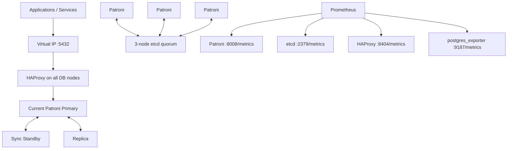

# PostgreSQL HA Ansible

> **Production reliability patch:** read [the patch rollout guide](docs/production-fixes.md)
> before running the changed automation. It documents the fixes, optional firewall
> and pgBackRest workflows, real validation commands and tests not run in the
> authoring environment. Existing reference HA test claims below do not constitute
> new validation of this revision.


> 🐘 A reusable, safety-first Ansible project for building and operating a three-node PostgreSQL high-availability cluster on Ubuntu 24.04 LTS.

## ✨ What this project provides

| Area | Status | What is included |
|---|---|---|
| PostgreSQL HA | ✅ Ready | PostgreSQL 16, Patroni, synchronous replication |
| DCS | ✅ Ready | Three-member etcd quorum |
| Client endpoint | ✅ Ready | Keepalived VIP + HAProxy TCP routing to the writable Primary |
| Storage | ✅ Ready | Dedicated data disk, LVM, XFS, online expansion runbook |
| Authentication | ✅ Hardened | SCRAM, Patroni-managed `pg_hba`, no `trust` rules |
| Access management | ✅ Capability | Declarative databases, roles, memberships and privilege profiles |
| Monitoring | ✅ Ready | Patroni `:8008`, etcd `:2379`, HAProxy `:8404`, postgres_exporter `:9187` |
| TLS | 🧩 Staged capability | Audit, certificate deployment and activation workflow |
| Network hardening | 🧩 Staged capability | Audit and reviewed CIDR model; enforcement disabled by default |
| OS hardening | 🧩 Staged capability | SSH/AppArmor framework; enforcement disabled by default |
| Backup/PITR | 🧩 Staged capability | WAL archive readiness and restore/PITR runbook |
| Logging | 🧩 Integration-ready | PostgreSQL logging audit and central-shipping placeholders |
| Patch management | 📘 Runbook | Rolling HA-safe maintenance workflow |
| Validation | ✅ Ready | Cluster topology, VIP, SQL write path, sync standby and service checks |

> **Design principle:** environment-changing or potentially disruptive capabilities are opt-in. Safe audits and validations can be run independently.

## 🏗️ Architecture



The reference topology uses **one PostgreSQL VM per failure domain**. PostgreSQL data remains on local block storage backed by LVM/XFS; shared storage is not required.

See [Architecture](docs/architecture.md) for the complete component and port model.

## 📦 Repository layout

```text
.
├── ansible.cfg
├── site.yml
├── requirements.yml
├── inventory/
│   └── production/
├── roles/
│   ├── common/
│   ├── storage/
│   ├── etcd/
│   ├── patroni/
│   ├── haproxy/
│   ├── keepalived/
│   ├── postgresql_access/
│   ├── postgresql_tls_files/
│   ├── postgresql_monitoring_exporters/
│   └── os_hardening/
├── playbooks/
├── monitoring/
├── examples/
├── scripts/
└── docs/
```

## 🚀 Quick start

### 0. Clone the repository

```bash
git clone <repository-url> postgresql-ha-ansible
cd postgresql-ha-ansible
```

Start by reading this README and the [Deployment Guide](docs/deployment-guide.md). Do not run `site.yml` until inventory, variables, Vault secrets and the target data disk have been reviewed for the target environment.

### 1. Prepare the Ansible control host

Install a supported Ansible Core release and required collections:

```bash
ansible-galaxy collection install -r requirements.yml
```

The control host must reach all database nodes over SSH and the Ansible user must have sudo privileges.

### 2. Configure inventory

Edit:

```text
inventory/production/hosts.yml
```

Example:

```yaml
pg-node-01:
  ansible_host: 10.10.20.11
  node_fqdn: pg-node-01.example.local
  postgres_data_device: /dev/sdb
  keepalived_priority: 150
```

Use stable `/dev/disk/by-id/...` paths when available.

### 3. Configure environment variables

Edit:

```text
inventory/production/group_vars/all/main.yml
```

Review at minimum:

- cluster VIP and DNS name;
- DNS/NTP servers;
- internal package repository access;
- PostgreSQL sizing;
- data disk safety threshold;
- monitoring source CIDRs;
- optional feature flags.

See [Configuration Reference](docs/configuration-reference.md).

### 4. Create the encrypted Vault file

```bash
cp inventory/production/group_vars/all/vault.yml.example \
   inventory/production/group_vars/all/vault.yml

ansible-vault encrypt inventory/production/group_vars/all/vault.yml
```

Never commit the decrypted Vault file or private key material. See [Secrets Management](docs/secrets-management.md).

### 5. Run preflight

```bash
ansible-playbook \
  -i inventory/production/hosts.yml \
  playbooks/preflight.yml \
  --ask-vault-pass -K
```

Preflight validates the OS, resources, repositories, DNS, NTP, node reachability, VIP safety and data disk conditions before deployment.

### 6. Deploy the cluster

> ⚠️ On a first deployment, confirm the intended empty data disk from the preflight output and then explicitly set `postgres_data_disk_allow_initialize: true`. Keep it `false` for a reusable/safe default and whenever disk initialization is not intended.

```bash
ansible-playbook \
  -i inventory/production/hosts.yml \
  site.yml \
  --ask-vault-pass -K
```

### 7. Apply PostgreSQL authentication hardening

```bash
ansible-playbook \
  -i inventory/production/hosts.yml \
  playbooks/harden-pg-hba.yml \
  --ask-vault-pass -K
```

### 8. Enable database/HA monitoring endpoints

```bash
ansible-playbook \
  -i inventory/production/hosts.yml \
  playbooks/enable-postgresql-monitoring-endpoints.yml \
  --ask-vault-pass -K
```

This enables:

```text
Patroni            <node>:8008/metrics
etcd               <node>:2379/metrics
HAProxy PROMEX     <node>:8404/metrics
postgres_exporter  <node>:9187/metrics
```

Host/VM metrics are intentionally outside this project.

### 9. Validate

```bash
ansible-playbook \
  -i inventory/production/hosts.yml \
  playbooks/validate.yml \
  --ask-vault-pass -K
```

For the complete safe readiness audit:

```bash
bash scripts/final-readiness-check.sh . --ask-vault-pass -K
```

## 🛡️ Safety model

The project deliberately separates **audit**, **prepare**, and **enforce** operations.

Examples of capabilities that remain disabled until explicitly configured:

```yaml
postgresql_network_hardening_enforce: false
postgresql_access_management_enabled: false
postgresql_tls_certificate_deployment_enabled: false
postgresql_tls_activation_enabled: false
os_hardening_enabled: false
postgresql_backup_management_enabled: false
postgresql_central_logging_enabled: false
postgresql_patch_automation_enabled: false
```

Monitoring endpoints are enabled in the reference configuration:

```yaml
postgresql_ha_monitoring_enabled: true
postgresql_exporter_enabled: true
haproxy_prometheus_enabled: true
```

## 📊 Monitoring

| Component | Port | Endpoint | Purpose |
|---|---:|---|---|
| Patroni | `8008` | `/metrics` | Role, streaming state, DCS health, pending restart |
| etcd | `2379` | `/metrics` | Quorum/leader and etcd operational metrics |
| HAProxy | `8404` | `/metrics` | Backend/server/session health |
| postgres_exporter | `9187` | `/metrics` | PostgreSQL statistics |
| HAProxy local UI | `7000` | `/stats` | Local-only human-readable statistics |

The PostgreSQL exporter uses a dedicated non-superuser `postgres_exporter` database role with `pg_monitor`, local Unix-socket `peer` authentication and no database password.

See [Monitoring](docs/monitoring.md).

## 🧪 HA test evidence

The reference implementation has been exercised with:

- ✅ planned Patroni switchover;
- ✅ Patroni service failure;
- ✅ complete Primary VM power-off;
- ✅ etcd quorum surviving one node loss;
- ✅ automatic former-Primary rejoin;
- ✅ writable VIP path after failover.

A hard VM-loss test observed roughly **29–30 seconds** of application write unavailability in the tested environment. This is a reference observation, **not a universal SLA**.

See [Failover & Switchover](docs/failover-and-switchover.md).

## 📚 Documentation

Start with [Documentation Index](docs/README.md) and [Project Completeness](docs/project-completeness.md).

Key guides:

- [Architecture](docs/architecture.md)
- [Ports & Endpoints](docs/ports-and-endpoints.md)
- [Deployment Guide](docs/deployment-guide.md)
- [Preflight Checks](docs/preflight.md)
- [Validation & Idempotency](docs/validation.md)
- [Operations Guide](docs/operations-guide.md)
- [Failover & Switchover](docs/failover-and-switchover.md)
- [Security Hardening](docs/security-hardening.md)
- [Configuration Reference](docs/configuration-reference.md)
- [Monitoring](docs/monitoring.md)
- [Backup & Restore](docs/backup-and-restore.md)
- [Troubleshooting](docs/troubleshooting.md)

## ⚠️ Production responsibilities

A repository can provide safe automation, but production readiness still depends on environment-specific decisions such as:

- reviewed firewall CIDRs;
- trusted PKI and certificate SAN design;
- backup repository and retention policy;
- tested restore/PITR procedure;
- central logging destination;
- maintenance windows and upgrade policy;
- disaster-recovery objectives.

Do not enable a placeholder capability without completing its documented prerequisites.
