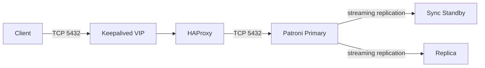
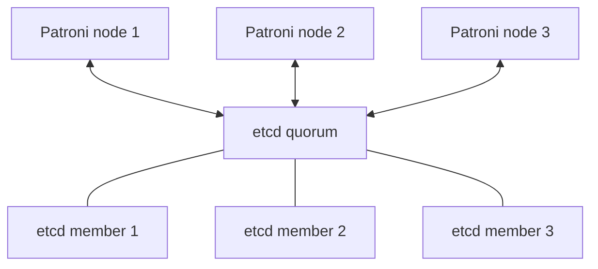
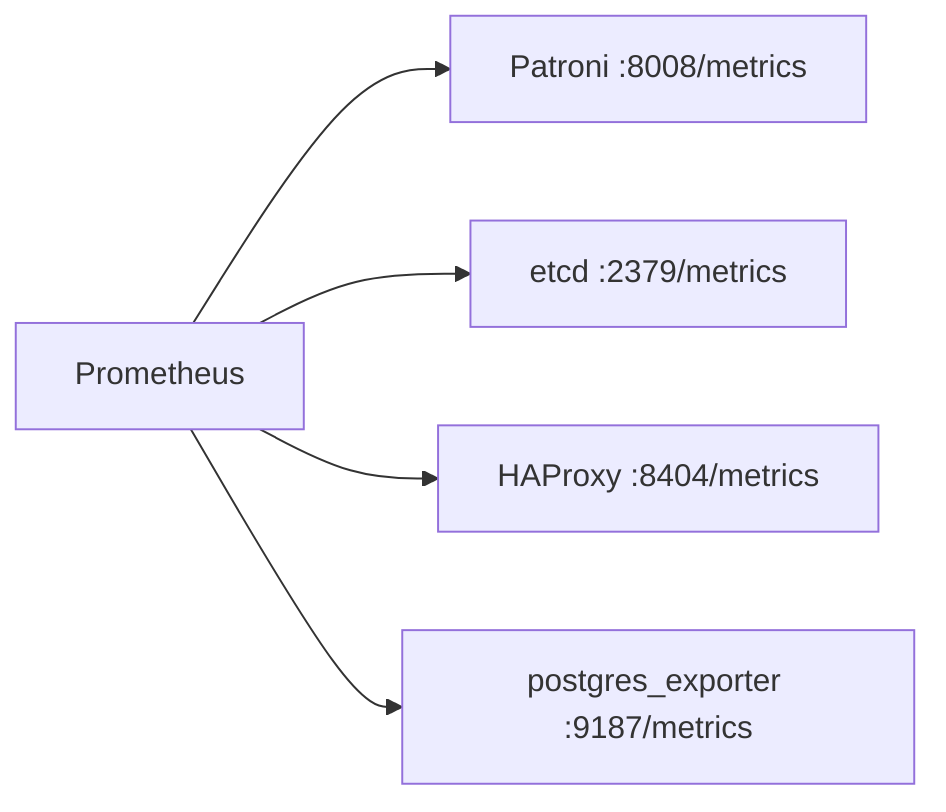

# 🏗️ Architecture


## 1. Goals

The architecture is designed for:

- three independent database failure domains;
- a single stable read/write endpoint;
- automatic Primary election;
- one synchronous standby;
- a second streaming replica;
- no shared filesystem requirement;
- explicit operational validation after changes.

## 2. Data path



HAProxy runs in TCP mode. It health-checks Patroni and routes PostgreSQL connections only to the node currently reporting the Primary role.

## 3. Control plane



Patroni stores cluster state and leader coordination in etcd. A three-member etcd cluster tolerates the loss of one member while retaining quorum.

## 4. Failure domains

Recommended placement:

```text
Physical host / failure domain A -> DB node 1
Physical host / failure domain B -> DB node 2
Physical host / failure domain C -> DB node 3
```

Avoid placing multiple PostgreSQL members on the same underlying failure domain when the infrastructure allows independent placement.

## 5. Storage

Reference data path:

```text
Dedicated virtual/block disk
  -> LVM physical volume
  -> vg_postgresql
  -> lv_postgresql
  -> XFS
  -> /var/lib/postgresql
```

PostgreSQL remains on local storage. The cluster does not depend on Ceph or a shared PostgreSQL filesystem.

## 6. HAProxy and Keepalived

Each node runs both services:

- **HAProxy** binds the PostgreSQL VIP on port `5432` and routes only to the current Patroni Primary.
- **Keepalived** owns the VIP on exactly one node using VRRP/unicast configuration.
- `net.ipv4.ip_nonlocal_bind=1` lets HAProxy remain configured on standby nodes even when they do not currently own the VIP.

The HAProxy local statistics listener remains bound to localhost.

## 7. Replication policy

Reference Patroni behavior:

```text
synchronous_mode: true
synchronous_mode_strict: false
synchronous_node_count: 1
```

This prioritizes synchronous durability while allowing Patroni to retain availability if a synchronous candidate is temporarily unavailable.

## 8. Monitoring architecture



Host-level metrics are intentionally outside this repository. Use the infrastructure monitoring platform for CPU, memory, filesystem, block I/O and network-interface metrics.

## 9. Port matrix

| Port / protocol | Component | Typical source | Purpose |
|---|---|---|---|
| `22/tcp` | SSH | Approved admin/Ansible networks | Management |
| `5432/tcp` VIP | HAProxy | Application networks | Stable PostgreSQL read/write endpoint |
| `5432/tcp` node | PostgreSQL | Cluster nodes / reviewed direct clients | PostgreSQL and replication |
| `8008/tcp` | Patroni REST | Cluster nodes / approved monitoring | Role health and metrics |
| `2379/tcp` | etcd client | Cluster nodes / approved monitoring | DCS client and metrics |
| `2380/tcp` | etcd peer | Cluster nodes | etcd replication |
| `8404/tcp` | HAProxy PROMEX | Approved monitoring | Prometheus metrics |
| `9187/tcp` | postgres_exporter | Approved monitoring | PostgreSQL metrics |
| `7000/tcp` localhost | HAProxy stats | Local host only | Human-readable local statistics |
| `112/ip` | VRRP | Cluster nodes | Keepalived VRRP |

Firewall enforcement must be based on real routing/SNAT behavior and reviewed CIDRs; do not copy example networks blindly.

## 10. TLS boundaries

PostgreSQL traffic uses TCP pass-through in HAProxy, so PostgreSQL TLS can terminate end-to-end on the active PostgreSQL server.

Treat these as separate TLS surfaces:

```text
PostgreSQL data plane
Patroni REST API
etcd client/peer traffic
```

Enabling one does not automatically secure the others.

When enabled, Patroni REST uses HTTPS with the configured CA and etcd uses
mutual TLS for both client and peer traffic. Health checks and operator probes
derive their scheme from the same inventory flags; no endpoint silently falls
back to plaintext after the switch.

## 11. Design constraints

- Exactly one writable Primary is expected.
- Reads are not load-balanced by this repository.
- The VIP is the normal application endpoint.
- Persistent PostgreSQL configuration belongs in Ansible/Patroni, not manual node edits.
- Environment-specific network, PKI, backup and logging values remain explicit inputs.
