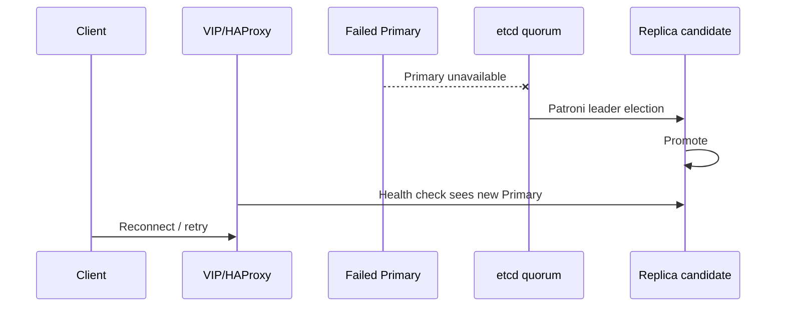

# 🔁 Failover & Switchover


## 1. Terminology

- **Switchover**: planned movement of the Primary role while the cluster is healthy.
- **Failover**: automatic or operator-assisted Primary replacement after a failure.
- **Rejoin**: a former Primary or failed replica returns as a streaming standby.

## 2. Planned switchover

Use Patroni:

```bash
sudo patronictl -c /etc/patroni/patroni.yml switchover
```

Do not use `pg_ctl promote` for normal cluster role changes; Patroni owns HA state.

### Pre-check

```bash
sudo patronictl -c /etc/patroni/patroni.yml list
```

Require:

```text
one healthy Leader
both standby members streaming
acceptable lag
a synchronous standby available
```

### Post-check

```bash
sudo patronictl -c /etc/patroni/patroni.yml list
```

Verify:

- exactly one Leader;
- old Leader rejoined;
- synchronous standby exists;
- VIP exists on exactly one node;
- SQL through VIP reaches a writable Primary.

## 3. Automatic Primary failure

Expected sequence:



The exact outage depends on Patroni timing, HAProxy checks, application retry behavior, network conditions and failure detection.

## 4. Reference test evidence

The reference implementation was tested with:

| Test | Result |
|---|---|
| Planned Patroni switchover | ✅ Pass |
| Patroni service failure on Primary | ✅ Automatic failover |
| Complete Primary VM power-off | ✅ Automatic failover |
| etcd after one node loss | ✅ Quorum retained at 2/3 |
| Former Primary return | ✅ Automatic streaming rejoin |
| VIP write path after failover | ✅ Writable |
| Replication after recovery | ✅ Lag returned to zero |

A complete Primary VM power-off produced approximately **29–30 seconds** of failed write probes in the tested environment.

> ⚠️ This value is test evidence, not a guaranteed SLA. Re-measure in every production network/application environment.

## 5. Patroni timing

Reference values:

```yaml
patroni_loop_wait: 10
patroni_retry_timeout: 10
patroni_ttl: 30
```

Do not reduce these values blindly. Patroni timing must satisfy its documented constraints and any tuning must be followed by the same hard-failure test.

## 6. Application behavior

Applications should:

- connect to the service DNS/VIP, not a fixed database node;
- use connection retry/backoff appropriate to the SLA;
- treat in-flight transactions as failed when the TCP session is lost;
- reopen connections after failover.

HA cannot preserve an already-broken TCP connection to a failed Primary.

## 7. One-node etcd failure

A three-member etcd cluster retains quorum with two healthy members. Do not take a second etcd member down while one member is unavailable.

## 8. Former Primary does not rejoin

Check:

```bash
sudo patronictl -c /etc/patroni/patroni.yml list
sudo journalctl -u patroni --since '-30 min'
```

Patroni is configured to use `pg_rewind` and replication slots. Do not immediately wipe/reinitialize a member. First determine whether it can rewind/rejoin normally.

If a deliberate reinitialize is eventually required, follow [Node Rebuild](node-rebuild.md) and verify another healthy standby exists first.

## 9. Validation playbook

After any role change:

```bash
ansible-playbook -i inventory/production/hosts.yml \
  playbooks/validate.yml --ask-vault-pass -K
```
